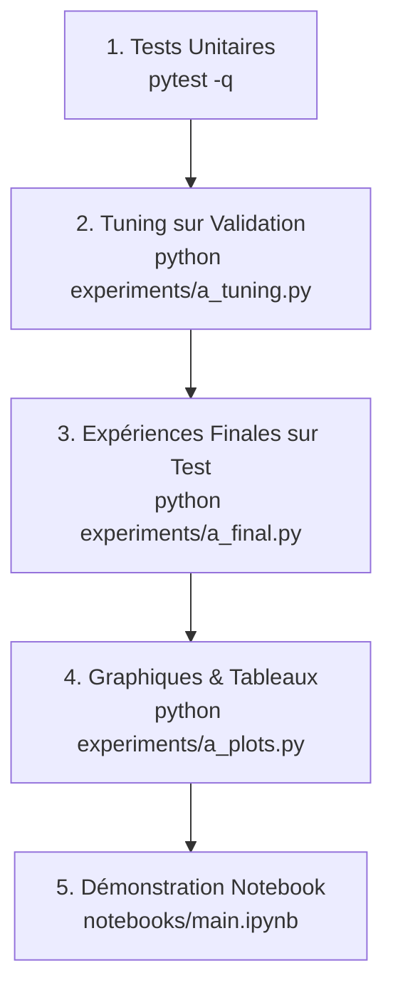

# Guide d'Exécution & Étapes d'Implémentation du Projet

**Auteurs :** Mohamed AASOUM & Hidaya EL HICHAMI  
**Encadrant :** Pr. R. AMATTOUCH  

Ce document constitue le guide de référence pour **exécuter le projet**, comprendre les **étapes d'implémentation** et présenter les résultats du benchmark.

---

## 1. Environnement & Démarrage Rapide

### 1.1. Activation de l'environnement Python
Le projet utilise l'environnement Conda configuré **`optimisation_env`** :

```powershell
& "C:\miniforge3\condabin\conda.bat" activate optimisation_env
```
*(Alternative directe : exécuter les scripts directement avec `& "C:\miniforge3\envs\optimisation_env\python.exe"`).*

### 1.2. Données requises
Le fichier de notes MovieLens 1M doit se trouver dans le dossier `data/` :
- `data/ratings.dat` (1 000 209 évaluations, délimiteur `::`).

---

## 2. Étapes d'Implémentation du Système

### Étape 1 — Fondations Communes & Préparation des Données
| Fichier | Rôle dans le projet |
|---|---|
| `src/data.py` | Chargement de MovieLens 1M (`load_movielens_1m`) et découpage vectorisé déterministe par utilisateur (`get_split`, graine 42). Garantit que chaque utilisateur a $\ge 1$ note dans `train`. |
| `src/metrics.py` | Calcul de l'erreur quadratique moyenne (`rmse`) et de l'erreur absolue moyenne (`mae`). |
| `src/protocol.py` | Constantes globales (`SEEDS = (0, 1, 2)`, $d = 10$), enregistrement strict des résultats (`append_result`) et mesure précise du temps et de la RAM crête (`measure`). |
| `src/base.py` | Classe abstraite `BaseRecommender` : interface unifiée pour tous les modèles (`fit`, `predict`, `score_all`, `recommend`). |

### Étape 2 — Métaheuristique PSO & Hybridation ALS
| Fichier | Rôle dans le projet |
|---|---|
| `src/fitness.py` | Formulation du problème d'optimisation `MFProblem` avec calcul SSE compilé en C natif via Numba parallèle (0.65 ms / évaluation). |
| `src/pso.py` | Recommandeur par Essaim Particulaire (`PSORecommender`) avec inertie décroissante $w \in [0.9, 0.4]$ et bornage des facteurs dans $[-1.0, 1.0]$. |
| `src/als_reference.py` | Solveur ALS de référence alternant la résolution des moindres carrés exacts sur matrices creuses CSR/CSC. |
| `src/hybrid.py` | Recommandeur hybride (`HybridRecommender`) qui explore d'abord l'espace avec le PSO, puis affine localement avec l'ALS. |
| `experiments/a_tuning.py` | Réglage des hyperparamètres sur le jeu de validation ($\lambda_{\text{ALS}} = 0.05$, PSO `init_std = 0.03`). |
| `experiments/a_final.py` | Entraînement final sur `train_full` et évaluation sur `test` pour 3 graines (0, 1, 2). Sauvegarde des facteurs `.npz`. |
| `experiments/a_plots.py` | Génération automatique des graphiques de convergence et du résumé Markdown `results/A_summary.md`. |
| `notebooks/main.ipynb` | Notebook interactif complet prêt pour la démonstration. |

### Étape 3 — Modèles de Référence (SGD, BPR, ALS) & Évaluation du Ranking
Le projet intègre ensuite les modèles comparatifs et les métriques de ranking :
1. **`src/als.py` :** Implémentation complète de production d'ALS (compatible avec `HybridRecommender` via l'argument `init=(U0, V0)`).
2. **`src/sgd.py` & `src/bpr.py` :** Modèles de descente de gradient stochastique (SGD) et Bayesian Personalized Ranking (BPR).
3. **Extension de `src/metrics.py` :** Implémentation des métriques `precision_at_k` et `recall_at_k` pour $k \in \{5, 10, 20\}$ sur notes pertinentes $\ge 4.0$.
4. **Évaluation du ranking :** Chargement des facteurs précalculés dans `results/models/*.npz` (`pso_d10_seed*.npz` et `pso+als_d10_seed*.npz`) pour compléter les colonnes `prec@k` et `rec@k` de `results/metaheuristics.csv`.
5. **`src/benchmark.py` :** Fusion comparative globale unifiée et analyse coût computationnel vs qualité.

---

## 3. Ordre Chronologique d'Exécution des Scripts



### Étape 1 : Valider tous les tests unitaires
```powershell
pytest -q
```
- **Durée :** ~17 secondes.
- **Résultat attendu :** `20 passed` (100% de succès sur les données, la fitness, le PSO et l'ALS).

---

### Étape 2 : Lancer le réglage des hyperparamètres (Validation)
```powershell
python experiments/a_tuning.py
```
- **Durée :** ~1 minute 30 secondes.
- **Résultats produits :**
  - Sélectionne $\lambda_{\text{ALS}} = 0.05$ $\implies$ écrit `configs/als_best.json`.
  - Sélectionne la configuration PSO optimale $\implies$ écrit `configs/pso_best.json`.
  - Sauvegarde `results/tuning_pso.csv`, `results/figures/tuning_pso.png` et `results/figures/hybrid_vs_als_val.png`.

---

### Étape 3 : Lancer les expériences finales sur le jeu de Test
```powershell
python experiments/a_final.py
```
- **Durée :** ~1 minute 40 secondes.
- **Résultats produits :**
  - Entraîne PSO et l'Hybride PSO+ALS sur `train_full` pour les 3 graines (0, 1, 2).
  - Évalue sur le jeu de test et remplit [results/metaheuristics.csv](file:///c:/Users/Asus%20ROG%20STRIX/Desktop/projet_optimisation/results/metaheuristics.csv).
  - Sauvegarde les facteurs latents dans [results/models/](file:///c:/Users/Asus%20ROG%20STRIX/Desktop/projet_optimisation/results/models/).
  - Sauvegarde les historiques de convergence dans [results/convergence/](file:///c:/Users/Asus%20ROG%20STRIX/Desktop/projet_optimisation/results/convergence/).

---

### Étape 4 : Générer les visualisations et le tableau résumé
```powershell
python experiments/a_plots.py
```
- **Durée :** ~3 secondes.
- **Résultats produits :**
  - Graphique de convergence : [results/figures/convergence_pso.png](file:///c:/Users/Asus%20ROG%20STRIX/Desktop/projet_optimisation/results/figures/convergence_pso.png).
  - Tableau synthétique de benchmark : [results/A_summary.md](file:///c:/Users/Asus%20ROG%20STRIX/Desktop/projet_optimisation/results/A_summary.md).

---

### Étape 5 : Exécuter et présenter le Notebook Jupyter
Le notebook interactif se trouve dans [notebooks/main.ipynb](file:///c:/Users/Asus%20ROG%20STRIX/Desktop/projet_optimisation/notebooks/main.ipynb).

Pour le lancer dans le navigateur :
```powershell
jupyter notebook notebooks/main.ipynb
```
*(Ou ouvrez-le directement dans VS Code avec le kernel `optimisation_env` et cliquez sur **Run All**).*

- Le notebook s'exécute de bout en bout en moins de 10 secondes (grâce au mode rapide `FAST = True`).
- Il affiche le chargement des données, le split, la démonstration interactive du PSO et de l'hybridation, et les courbes de convergence.

---

## 4. Présentation des Livrables

1. **Le Notebook :** [notebooks/main.ipynb](file:///c:/Users/Asus%20ROG%20STRIX/Desktop/projet_optimisation/notebooks/main.ipynb)  
   Présente le code interactif, la démonstration de la métaheuristique, le raffinement local et l'affichage des graphiques.
2. **Le Benchmark :** Le tableau [results/A_summary.md](file:///c:/Users/Asus%20ROG%20STRIX/Desktop/projet_optimisation/results/A_summary.md) et le fichier [results/metaheuristics.csv](file:///c:/Users/Asus%20ROG%20STRIX/Desktop/projet_optimisation/results/metaheuristics.csv) démontrant que les runs ont été exécutés sur 3 graines avec mesures de temps et de mémoire crête.
3. **Le Fonctionnement Théorique & Résultats :** Détaillés dans [README.md](file:///c:/Users/Asus%20ROG%20STRIX/Desktop/projet_optimisation/README.md) pour servir de base directe à la rédaction du rapport.
