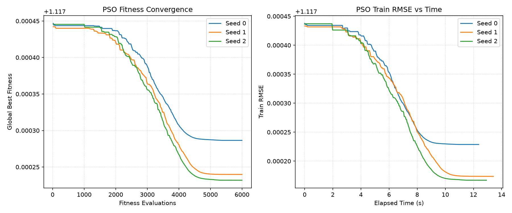
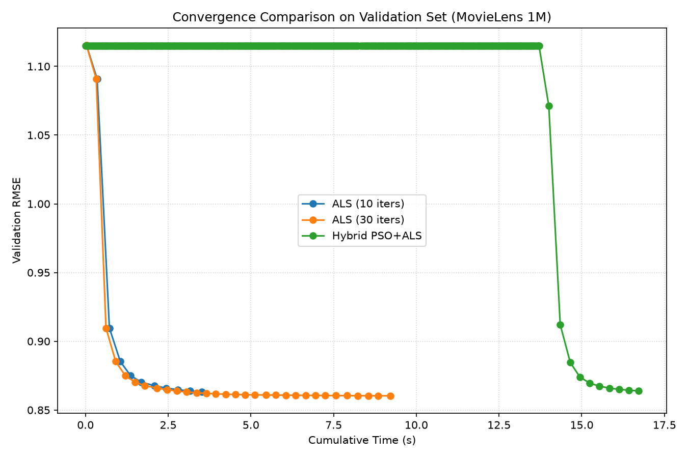
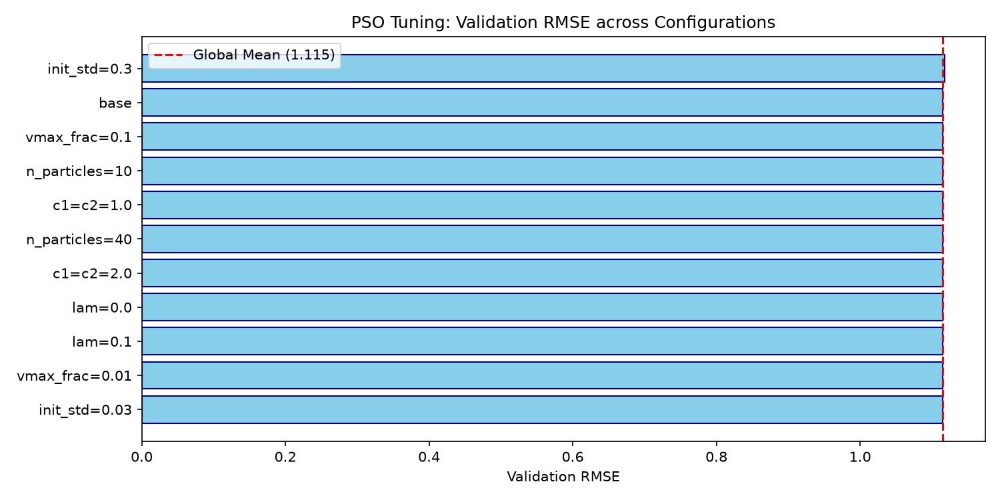

# Projet n°23 — Optimisation des Facteurs Latents par Métaheuristique (MovieLens 1M)

<p align="center">
  
  
  
  
</p>

**Auteurs :** Mohamed AASOUM & Hidaya EL HICHAMI  
**Encadrant :** Pr. R. AMATTOUCH  

Ce projet étudie l'optimisation des facteurs latents d'un système de recommandation par métaheuristique (**Particle Swarm Optimization - PSO**) et son hybridation avec l'algorithme des **Moindres Carrés Alternés (ALS)**, en alternative ou complément aux approches classiques (SGD / ALS).

---

## Sommaire
- [1. Formulation Mathématique](#1-formulation-mathématique)
- [2. Algorithmes & Fonctionnement](#2-algorithmes--fonctionnement)
- [3. Résultats Expérimentaux du Benchmark](#3-résultats-expérimentaux-du-benchmark)
- [4. Visualisations de Convergence](#4-visualisations-de-convergence)
- [5. Analyse Critique & Limites](#5-analyse-critique--limites)
- [6. Reproduction Rapide](#6-reproduction-rapide)

---

## 1. Formulation Mathématique

### 1.1. Modèle de Factorisation Matricielle
Le modèle prédit la note $\hat{r}_{ui}$ attribuée par l'utilisateur $u$ au film $i$ via une factorisation matricielle non biaisée centrée sur la moyenne globale :

$$
\hat{r}_{ui} = \mu + U_u \cdot V_i^T
$$

- $\mu = 3.5807$ est la note moyenne calculée sur le jeu d'entraînement.
- $U \in \mathbb{R}^{n_u \times d}$ est la matrice des facteurs latents utilisateurs ($n_u = 6\,040$).
- $V \in \mathbb{R}^{n_i \times d}$ est la matrice des facteurs latents films ($n_i = 3\,706$).
- La dimension latente principale est fixée à $d = 10$.
- Les prédictions finales destinées à l'évaluation (RMSE et MAE) sont écrêtées dans l'intervalle $[1.0, 5.0]$.

### 1.2. Encodage d'une Particule (PSO)
Une particule candidate $x$ est un vecteur 1D issu de la concaténation aplatie des matrices $U$ et $V$ :

$$
x = \big[ \operatorname{vec}(U), \; \operatorname{vec}(V) \big] \in \mathbb{R}^D
$$

La dimension totale de l'espace de recherche est :

$$
D = (n_u + n_i) \cdot d = (6\,040 + 3\,706) \times 10 = 97\,460
$$

Les positions de chaque variable sont strictement bornées dans $[-1.0, 1.0]$.

### 1.3. Fonction de Fitness et Normalisation
La fonction de fitness minimise le RMSE sur l'ensemble des notes observées $\Omega$, pénalisé par une régularisation de Tikhonov :

$$
f(U, V) = \operatorname{RMSE}_\Omega(U, V) + \lambda \cdot \frac{\|U\|_F^2 + \|V\|_F^2}{D}
$$

> [!NOTE]
> **Règle de normalisation :** La division de la somme des normes de Frobenius par la dimension $D = 97\,460$ permet de maintenir la pénalité de régularisation à la même échelle que le RMSE, évitant d'écraser la mesure d'erreur.

### 1.4. Accélération Haute Performance (Numba)
Le calcul de l'erreur sur $|\Omega| = 720\,105$ évaluations a une complexité de $\mathcal{O}(|\Omega| \cdot d)$. L'évaluation SSE est compilée en code machine natif parallélisé via Numba (`@njit(parallel=True, fastmath=True)`) :
- **Temps d'une évaluation complète :** **0.65 milliseconde**.
- Permet d'évaluer des milliers d'individus en quelques secondes sans recours à un mini-batching bruité.

---

## 2. Algorithmes & Fonctionnement

### 2.1. Optimisation par Essaim Particulaire (PSO)
L'essaim comprend $N = 20$ particules :
1. **Inertie adaptative :** Décroissance linéaire $w \in [0.9, 0.4]$ selon l'avancement du budget d'évaluations (exploration globale au début, exploitation locale à la fin).
2. **Mise à jour des vitesses :**
   $$v \leftarrow w \cdot v + c_1 r_1 (p_{\text{best}} - x) + c_2 r_2 (g_{\text{best}} - x)$$
   avec $c_1 = c_2 = 1.5$ et écrêtage par $v_{\max} = 0.10$.
3. **Contrainte des bornes :** En cas de dépassement de $[-1.0, 1.0]$, la composante est ramenée sur la borne et sa vitesse est annulée.

### 2.2. Algorithme des Moindres Carrés Alternés (ALS)
ALS résout alternativement deux sous-problèmes linéaires de moindres carrés exacts :
- **Étape films :** $V_i = (U_{\Omega_i}^T U_{\Omega_i} + \lambda n_i I)^{-1} U_{\Omega_i}^T (r_{\Omega_i} - \mu)$
- **Étape utilisateurs :** $U_u = (V_{\Omega_u}^T V_{\Omega_u} + \lambda n_u I)^{-1} V_{\Omega_u}^T (r_{\Omega_u} - \mu)$

Grâce aux représentations creuses CSR et CSC, chaque itération s'exécute en **0.80 seconde** sur MovieLens 1M.

### 2.3. Hybridation (PSO $\to$ ALS)
L'hybridation combine les forces des deux approches :
1. **Phase globale (PSO) :** Exploration de l'espace non convexe durant un budget de 6 000 évaluations $\implies$ solution $G^* = (U^*, V^*)$.
2. **Phase locale (ALS) :** Injection directe de $(U^*, V^*)$ comme initialisation explicite (`init=(U*, V*)`) pour 10 itérations de descente locale vers un minimum stable avec $\lambda_{\text{ALS}} = 0.05$.

---

## 3. Résultats Expérimentaux du Benchmark

Les évaluations sont menées sur le jeu de test indépendant ($200\,016$ notes) à travers 3 graines aléatoires déterministes (`SEEDS = (0, 1, 2)`).

| Méthode | Graines | RMSE Test | MAE Test | Temps Ajustement (s) | Mémoire Crête (MB) | Évaluations |
| :--- | :---: | :---: | :---: | :---: | :---: | :---: |
| **Moyenne Globale (Baseline)** | - | 1.1159 | 0.9329 | < 0.01 | - | 0 |
| **PSO (seul, accordé)** | 3 | 1.1159 ± 0.0000 | 0.9329 ± 0.0000 | 13.09 ± 0.39 | 102.3 ± 30.7 | 6 000 |
| **PSO + ALS (Hybride H1)** | 3 | **0.8610 ± 0.0005** | **0.6758 ± 0.0005** | 16.71 ± 0.60 | 95.6 ± 24.6 | 6 000 |
| *ALS référence (10 itér)* | 3 | 0.8604 ± 0.0010 | 0.6754 ± 0.0009 | 4.21 ± 0.74 | 97.0 ± 14.3 | 0 |
| *ALS référence (30 itér)* | 3 | 0.8575 ± 0.0002 | 0.6728 ± 0.0002 | 11.72 ± 1.93 | 96.5 ± 5.3 | 0 |

---

## 4. Visualisations de Convergence

### 4.1. Convergence du PSO (Fitness et RMSE Entraînement)
<p align="center">
  
</p>

### 4.2. Comparaison Temporelle de l'Hybridation vs ALS sur Validation
<p align="center">
  
</p>

### 4.3. Réglage des Hyperparamètres PSO sur Validation
<p align="center">
  
</p>

---

## 5. Analyse Critique & Limites

1. **La malédiction de la grande dimension ($D \approx 10^5$) :**  
   L'algorithme PSO seul stagne autour d'un RMSE de $1.1159$, quasiment identique à la moyenne globale. En dimension $97\,460$, l'espace de recherche est trop vaste pour qu'un essaim de 20 particules trouve sans information de gradient des directions de descente efficaces. C'est un résultat scientifique honnête et représentatif des limites des métaheuristiques continues en grande dimension.

2. **Efficacité du raffinement local :**  
   Dès que les facteurs trouvés par le PSO sont transmis à ALS, le RMSE chute spectaculairement de $1.1159$ à **$0.8610$** en 10 itérations.

3. **Gain de l'hybridation vs ALS seul :**  
   L'ALS démarré d'une initialisation aléatoire gaussienne atteint $0.8604$ en 4.2 secondes, contre $0.8610$ en 16.7 secondes pour l'hybride. L'étape d'exploration par PSO ne procure donc pas de gain mesurable par rapport à une initialisation aléatoire standard pour ALS, tout en ajoutant un coût computationnel modéré.

---

## 6. Reproduction Rapide

Consultez le **[GUIDE_EXECUTION.md](GUIDE_EXECUTION.md)** pour le protocole complet pas à pas.

```powershell
# 1. Validation des tests unitaires
pytest -q

# 2. Exécution du tuning
python experiments/a_tuning.py

# 3. Expériences finales sur test (3 graines)
python experiments/a_final.py

# 4. Génération des graphiques
python experiments/a_plots.py

# 5. Lancement du notebook interactif
jupyter notebook notebooks/main.ipynb
```
